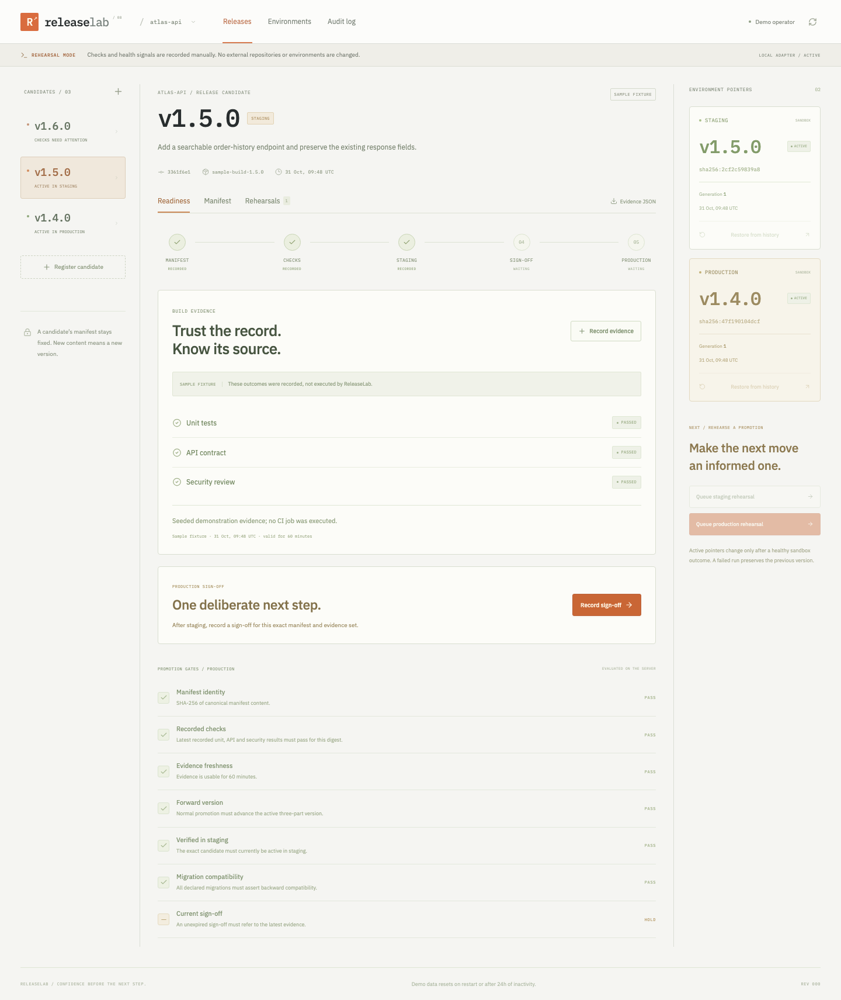

# ReleaseLab

**A release-control sandbox for immutable candidates, evidence gates, promotion rehearsals and traceable restore operations.**

ReleaseLab models what must remain consistent around a release: the candidate identity, recorded build outcomes, staging verification, a deliberate sign-off and the environment generation being changed. Its interface is a light engineering workbench with monospaced identifiers, a visible release route and orange action controls.



## What is real, and what is rehearsed

The application implements real server-side validation, SHA-256 manifest identities, persisted state transitions, optimistic concurrency, idempotency receipts and transactional audit snapshots. The deployment adapter is deliberately a **sandbox**: it changes an environment pointer in SQLite. It does not build images, execute CI jobs, run a security scanner, probe a remote service or modify external infrastructure.

Unit/API/security outcomes and health signals in the product UI are manually recorded demonstration inputs. Seeded evidence and deployment history are marked as sample fixtures. The repository's GitHub Actions workflow separately runs actual tests for **ReleaseLab itself**; those application checks are distinct from the recorded outcomes inside the demo.

## Try the full lifecycle

1. Select **Open the sandbox**. An isolated workspace starts with `atlas-api`, three candidates and two clearly labeled sample deployments.
2. Open `v1.5.0`, currently active in the simulated staging environment.
3. Select **Record sign-off** and record a review note tied to this manifest and its latest evidence.
4. Select **Queue production rehearsal** and confirm the captured environment generation.
5. Advance **Start sandbox run → Begin health verification → Report healthy**.
6. Open **Environments**. Production now points to `v1.5.0`, with a higher generation and a successful journal entry.
7. Select production's **Restore from history**, choose the earlier `v1.4.0` snapshot, record a reason and advance that rehearsal.
8. Inspect **Audit log** or download **Evidence JSON** for the candidate.

To explore a failure, register a new candidate, record passing build evidence, queue it for staging and report failing health. The attempted run becomes failed; the active environment stays unchanged.

## Implemented behavior

- Immutable release manifests with unique stable three-part versions, source/build metadata, dependency declarations, migration compatibility flags and configuration key names.
- Deterministic SHA-256 identities calculated from the server's stable JSON representation of manifest content.
- Immutable evidence sets tied to the exact digest, with explicit manual/sample provenance and a 60-minute freshness window.
- Single-operator sign-off tied to the current digest and latest evidence, with expiry and audit notes.
- Staging and production gate evaluation, including numeric version advancement and current staging identity.
- Queued, running, verifying, succeeded, failed and cancelled operation states.
- Per-environment active-operation admission and compare-and-swap generation checks.
- Revalidation during advancement, so changed evidence, expired gates, a changed staging candidate or altered environment generation stops a stale rehearsal.
- Restore from earlier successful journal snapshots, with an explicit reason and its own health outcome.
- Before/after environment snapshots in the audit log, plus portable evidence JSON downloads.
- Isolated disposable workspaces, API session/CSRF/Origin controls and bounded storage.

## Candidate identity

A manifest contains `service`, `version`, `source_commit`, `build_ref`, `dependencies`, `migrations` and `config_keys`. The supported version format is the stable `major.minor.patch` core, with no leading zeroes, prerelease suffixes or build metadata. Normal promotion compares numeric tuples rather than lexicographic strings.

The digest identifies **manifest JSON**, not container bytes or a compiled binary. Object keys are serialized in sorted order; array order remains significant. Source commits and build references are user-recorded metadata, not remotely verified attestations. Config fields accept key names only, never secret values.

Once registered, the manifest and notes cannot be edited through the API. A changed artifact requires a new version. Evidence and sign-off history can grow without changing the manifest digest; their own record IDs and the candidate's concurrency version track those changes.

## Gates

| Gate                                                               | Staging  | Production |
| ------------------------------------------------------------------ | -------- | ---------- |
| Manifest matches stored digest                                     | Required | Required   |
| Latest recorded unit/API/security results all pass for this digest | Required | Required   |
| Evidence is no older than 60 minutes                               | Required | Required   |
| Candidate version advances the currently active version            | Required | Required   |
| Exact candidate is currently active in staging                     | —        | Required   |
| All declared migrations assert backward compatibility              | —        | Required   |
| Current unexpired sign-off references the latest evidence          | —        | Required   |

Migration compatibility is an operator-provided declaration. The app does not analyze or execute migration code. Sign-off is a record made by the workspace's single anonymous operator, not an independent reviewer, verified identity or cryptographic signature.

Recording new evidence makes older sign-offs inapplicable, including when the new results still pass. Queued operations capture the evidence/sign-off IDs they relied on. A later replacement or expiry prevents that operation from completing against an obsolete decision.

## State machine and pointer safety

```text
queued -> running -> verifying -> succeeded
   |         |           |
   +---------+-----------+----> cancelled
             |
       stale gate / bad health -> failed
```

A valid final healthy signal commits the candidate pointer, manifest digest, environment generation, operation state, activity and request receipt in the same SQLite transaction. The active pointer does not change at queue/start/verification time. Failed and cancelled operations preserve it. Terminal operations cannot be restarted; a new attempt creates a new operation.

Every operation captures the environment generation. Queue and advance commands recheck that generation, and only one active rehearsal may exist per environment. Different environments can have active rehearsals concurrently. Production still rechecks its staging prerequisite, so a newer staging candidate can invalidate an older production attempt.

Keyed commands record a canonical action/payload fingerprint. Replaying a completed key returns the current workspace and original result identifiers without repeating effects. Changing the payload with the same key conflicts. The browser retains pending keys after ambiguous network/server failures, but does not implement a durable offline queue.

## Restore semantics

Restore selects an earlier successful record **from the same environment**, excluding the currently active artifact. It bypasses fresh build/sign-off gates as an explicit operator action with a mandatory reason. It still validates its target, manifest identity, environment generation, operation version and health outcome.

Restore changes only the simulated active artifact pointer. It does not reverse schema or data changes, restore a database backup or guarantee real-world rollback compatibility. The target may come from labeled sample history; its provenance remains visible.

## Architecture and stack

| Layer          | Implementation                                              |
| -------------- | ----------------------------------------------------------- |
| Client         | React 19, TypeScript, CSS, Lucide icons                     |
| Frontend build | Vite 6                                                      |
| API            | Python 3.12, FastAPI, Pydantic                              |
| Domain         | Explicit release/operation state machine and gate functions |
| Storage        | Standard-library SQLite, bounded JSON workspace aggregate   |
| Checks         | pytest, HTTP integration tests, Playwright, GitHub Actions  |
| Packaging      | Multi-stage Docker image; one web service                   |

```text
React candidate / environment / audit workbench
                        |
FastAPI -> session + CSRF + input validation
                        |
     immutable manifests / evidence / sign-off
                        |
     gates + operation version + environment generation
                        |
          transactional SQLite workspace
     pointer + operation + audit + request receipt
```

Mutations run under a reentrant lock and a SQLite `BEGIN IMMEDIATE` transaction. Tests force a write failure during the final pointer change and verify that the entire workspace remains unchanged. Requests from another workspace cannot access a candidate by guessing its ID.

The UI requests snapshots after commands and offers manual refresh. There are no background workers, automatic deployments or live production monitoring. Fonts use IBM Plex Sans/Mono from Google Fonts when available, with local fallbacks.

## Run locally

Requires Python 3.12 and Node.js 24.

```sh
python3 -m venv .venv
.venv/bin/pip install -r requirements.lock
npm ci --prefix frontend
npm run build --prefix frontend
.venv/bin/uvicorn backend.app:create_app --factory --host 127.0.0.1 --port 3800
```

Open `http://127.0.0.1:3800`. No repository token, setup key, managed database or cloud credentials are needed inside the application.

For frontend development, run the API and `npm run dev --prefix frontend`, then open port `3801`. For optional local persistence, export `DATABASE_PATH=./data/releases.sqlite` before starting the API. `.env.example` documents the configuration; the Python server does not automatically load it.

## Verification

```sh
.venv/bin/python -m pytest -q
npm run build --prefix frontend
npm run test:e2e --prefix frontend
```

The tests cover manifest/version validation, gate freshness, invalidation, sign-off, staging identity changes, generation conflicts, operation versions, healthy/failed/cancelled transitions, restore targets, idempotency, forced rollback, workspace isolation, HTTP controls, evidence export and full browser workflows.

See [architecture/API](docs/ARCHITECTURE.md), [verification evidence](docs/VERIFICATION.md), [CV/LinkedIn wording](docs/PORTFOLIO.md), [GitHub guide in Russian](docs/GITHUB_UPLOAD_RU.md) and [future work](docs/ROADMAP.md).

## Demo and deployment boundaries

The public service uses in-memory SQLite. Restarting clears all workspaces; sessions also expire after 24 hours of inactivity. Optional file-backed storage survives restarts while retaining idle expiry. Expired rows are pruned when new workspaces are created.

Limits are 100 workspaces; 25 candidates, 120 operations and 2,000 keyed commands per workspace; 20 evidence records and 10 sign-offs per candidate; 200 retained audit entries; 1.5 MiB per serialized workspace and 48 MiB combined payload. Bodies are capped at 100 KB including streamed requests. Session creation is rate-limited by observed peer address. These are operating bounds, not benchmarked production capacity.

Hosted cookies are Secure, HttpOnly and SameSite=Strict. Tokens are stored as digests; mutating requests use CSRF and Origin checks. Names are display labels, not durable authenticated identities. The project does not implement production IAM, two-person approval, signed CI attestations, registry verification or external deploy hooks.

The Dockerfile serves the built client and Python API on one service. Set `HOST=0.0.0.0`, platform `PORT`, `COOKIE_SECURE=true` and `APP_ORIGIN` or Render's injected `RENDER_EXTERNAL_URL`. Keep `DATABASE_PATH=:memory:` for a disposable demo. Health is exposed at `/api/health`. Use one worker; shared coordination/storage would be needed for a distributed control plane. Free hosting can sleep between visits.
